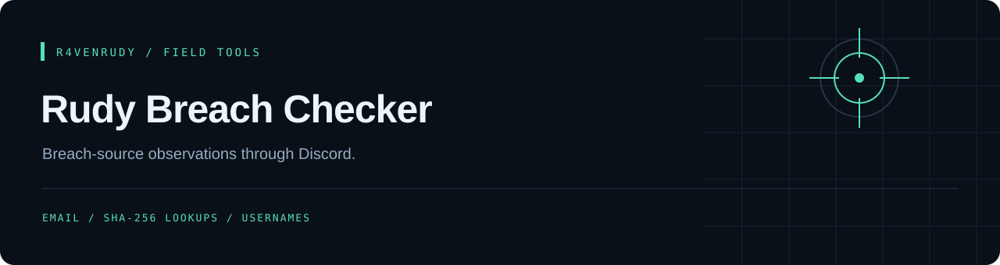

<p align="center"></p>

<p align="center">
  
  
  <a href="LICENSE"></a>
</p>

<p align="center"><strong>Breach-source observations through Discord.</strong></p>

<p align="center"><a href="#overview">Overview</a> · <a href="#capabilities">Capabilities</a> · <a href="#quick-start">Quick start</a> · <a href="#implementation-notes">Implementation notes</a></p>

---

## Overview

A Discord bot that sends email, hashed-email or username queries to a configured breach-lookup endpoint and formats the provider's response. The code expects `found`, `sources` and `fields` properties; provider compatibility must be configured and verified.

## Capabilities

| Command | Implemented behavior |
| :--- | :--- |
| `/mail` | Validates, trims and lowercases the email, then sends it as the endpoint's `check` query parameter |
| `/hashmail` | Lowercases/trims the email, hashes it with SHA-256 and queries that hash; a 64-character SHA-256 is sent as is |
| `/usernamev2` | Queries a supplied username; a leading `@` is dropped and blank input is rejected |
| Response | Displays source names/dates and exposed-field labels when returned by the provider, only to the user who asked (ephemeral) |
| Colors | Red = found in breaches, green = not found, orange = API error or unexpected response |
| Limits | Each user waits `COOLDOWN_SECONDS` (default 10) between lookups; emails are capped at 254 characters and usernames at 64 |

## Quick start

Requires Node.js with a built-in global `fetch`, a Discord application and a compatible lookup API. Keep `raven.png`; startup requires the file to be at least 1 KB.

```bash
git clone https://github.com/r4venrudy/rudy-breach-checker.git
cd rudy-breach-checker
npm install
```

Set the `DISCORD_TOKEN`, `CLIENT_ID` and `LEAKCHECK_API` environment variables (for example `DISCORD_TOKEN=... CLIENT_ID=... LEAKCHECK_API=... node index.js`). Startup rejects missing configuration before connecting to Discord. The endpoint must accept `?check=...` and return JSON in this shape (anything without a boolean `found` is reported as an unexpected response):

```json
{
  "found": true,
  "sources": [{ "name": "ExampleForum", "date": "2023-05" }, "OtherSite"],
  "fields": ["email", "password", "username"]
}
```

`sources` entries can be plain names or `{ name, date }` objects (dated ones are listed newest first); `fields` lists the exposed data types. If your provider needs a key, set `LEAKCHECK_API_KEY` (sent as the `X-API-Key` header, or the header named in `LEAKCHECK_API_KEY_HEADER`), so the key stays out of the URL.

```bash
node index.js
```

Invite the bot with `bot` and `applications.commands` scopes. Test with a consented test account after configuring your provider.

## Implementation notes

- This repository contains a provider adapter, not a breach database. A `found: false` response does not establish that an account is safe or absent from every breach.
- `/hashmail` hashes the full email with SHA-256. It is not a k-anonymity protocol; only providers supporting that hash format can return useful matches.
- Queries go to the configured provider and results are shown only to the user who ran the command (ephemeral replies). Malformed email addresses are rejected before any API call. Avoid submitting another person's personal information without permission.
- Requests time out after 15 seconds, network failures name their cause (for example `ENOTFOUND`), and long source lists are cut to fit Discord's embed limit with a "more part(s) not shown" footer. Live provider authentication and behavior were not tested in this documentation review.

## Project map

```text
index.js                Slash commands and the breach API adapter
packaging/api.cjs       Breach API request and response checks
packaging/embed.cjs     Result embed (plain Discord API object)
packaging/format.cjs    Hashing, source lines, size budget, markdown-safe code spans
packaging/cooldown.cjs  Per-user cooldown
packaging/config.cjs    Environment / RUDY_CONFIG loading
packaging/*.test.cjs    Tests (npm test)
package.json            Discord dependency
raven.png               Required startup asset
```

## GitHub package

A non-root container is published to GitHub Packages after build and offline configuration checks. Credentials are supplied at runtime and are excluded from the image.

```sh
cp .env.example .env
# Fill in your own values in .env, keeping that file private.
docker run --rm --env-file .env ghcr.io/r4venrudy/rudy-breach-checker:latest --check-config
docker run --rm --env-file .env ghcr.io/r4venrudy/rudy-breach-checker:latest
```

`--check-config` validates installed dependencies, the bundled asset, and required settings without connecting to Discord. `RUDY_CONFIG` optionally points to a mounted JSON configuration file; environment variables take priority.

Only public project files are packaged. Image tags are `latest` and `sha-<full commit SHA>`. Discord login and external API behavior still require your own account configuration; CI never uses live credentials.


## License

[MIT](LICENSE). Preserve the attribution in the license file.

---

<p align="center">Part of the <a href="https://github.com/r4venrudy">r4venrudy</a> project collection.</p>

Local configuration files must be UTF-8 JSON objects no larger than 64 KiB. Reads are bounded by bytes, and invalid UTF-8 is rejected before credential validation.
